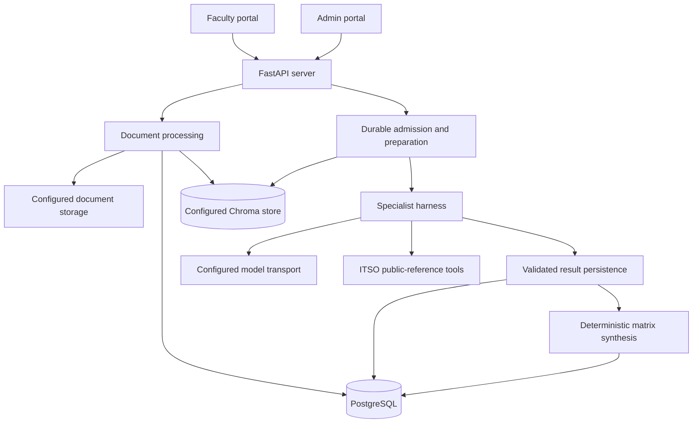

# EquipED architecture

EquipED is a pnpm and uv monorepo: two React applications, one FastAPI modular
monolith, shared frontend libraries, and an installable specialist harness.
[Product scope](PRODUCT.md) and [requirements](PRD.md) define its purpose.

## Boundaries

| Component | Responsibility |
| --- | --- |
| `apps/faculty` | Document library, specialist workspaces, alignment, history, and result review. |
| `apps/admin` | References, rubrics, objectives, accounts, monitoring, feedback, and model administration. |
| `apps/server` | Authorization, document processing, retrieval, durable execution, model resolution, persistence, and synthesis. |
| `libs/evaluation-harness` | Specialist pipelines, prompts, rubric interpretation, scoring, semantic validation, and public-reference tools. |
| `libs/auth`, `libs/api-client`, `libs/types`, `libs/ui` | Shared sessions, API access, contracts, and design primitives. |
| `infra` | Reverse-proxy and database operating resources. |
| `training` | Standalone training, serving integration, and validation tools. |

Server `core` is infrastructure-only; domain behavior belongs to modules.
Frontend features are self-contained, with shared behavior in libraries.
The harness receives immutable prepared inputs, controls, explicit tools, and a
model-client adapter. It has no server, ORM, Chroma, or settings dependency.
The server supplies authorized data and persists validated results; the harness
interprets evidence and executes specialist workflows.

## Evaluation flow

A single worker/drainer uses database claims, heartbeats, and recovery to protect
job ownership. Worker threads receive immutable context instead of shared ORM
sessions. There is no external message broker or distributed execution tier.

New faculty jobs run one selected Layer 3 specialist. Outputs are persisted before
terminal Layer 4 synthesis; recovery can resume synthesis from saved outputs.
Required-agent failures fail the job. Explicit administrative and historical
bundles retain their full or intentional-partial semantics. The document matrix
progresses independently; its composite requires all four domains. Synthesis
makes no further model judgments.

## Documents and retrieval

PDF ingestion extracts selectable text and uses configured OCR. Chunks preserve
source/page identities. Ingestion errors fail closed; reference ingestion becomes
ready after successful vector writes.

Institutional reference vectors are separate from Coordinator's document-scoped
SLM collections. Its index is reused only when source identity and embedding
model match. Retrieval returns bounded exact passages from the selected module;
failed indexing or retrieval prevents execution. Other specialists retain their
own source preparation.

ITSO requires public search and source-page retrieval. Only public citation
details or lesson/topic names enter queries. Pages are untrusted evidence;
destination checks, transport bounds, and coverage reporting apply.

PostgreSQL holds accounts, metadata, jobs, snapshots, results, feedback, and
training records. Binaries use configured local/private object storage. Chroma
holds vectors and associated text/metadata. A SQL backup alone does not recover
binaries or vectors.

## Alignment and compatibility

Server `modules/alignment` contains independent curriculum and syllabus checks.
They own their workflows, evaluators, and persistence and do not contribute
specialist matrix scores.

Immutable snapshots and saved response contracts preserve historical meanings.
Version identifiers describe compatibility contracts. Historical ITSO assessments
remain server-owned read services; current scored ITSO uses standard evaluations.
See the [harness API and compatibility guide](libs/evaluation-harness/README.md).

## Access and deployment

Both portals share an HTTP-only session cookie and server-side authorization.
Faculty access is ownership-scoped. Cross-application navigation uses a common
origin. Caddy routes APIs to FastAPI, administrative routes to Admin, and other
application routes to Faculty. The Faculty Vite proxy provides a local fallback.
The current Admin development module namespace and proxy matchers require
deployment-specific verification; Compose files do not certify readiness.

Storage and inference are local/private by default. Explicitly authorized Chroma
Cloud can hold reference and document-scoped vectors with text/metadata; this
does not authorize external inference. Policy evidence retains its private-model
residency gate.

See [setup](docs/setup.md), [operations](docs/operations.md), and
[evaluation](docs/evaluation.md).
