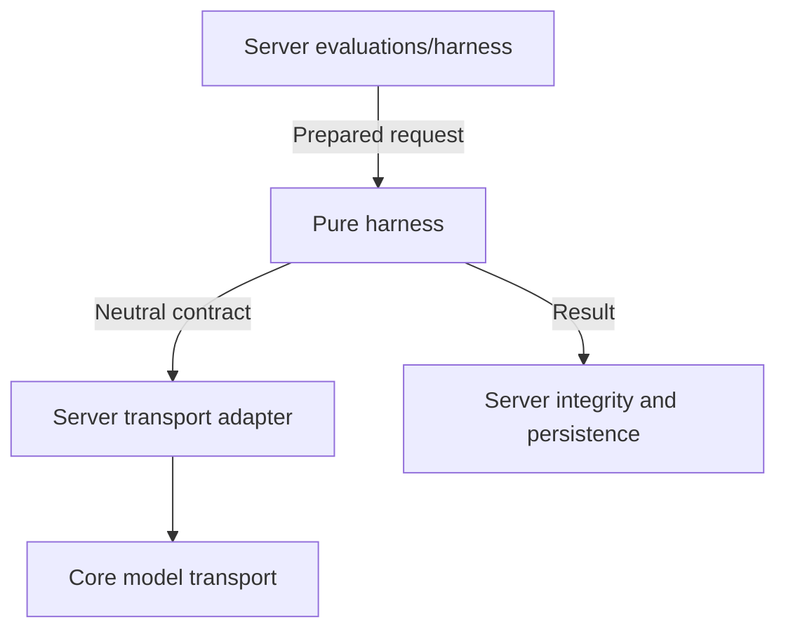

# EquipED evaluation harness

Installable, in-process Python package for the actual SME, Coordinator, GAD and
ITSO evaluation pipelines, laid out directly under `equiped_harness/` with specialist domains at `equiped_harness/{sme,coordinator,gad,itso}/`. Owns prompts, pure scoring, semantic rubric contracts,
strategy calculators, immutable snapshot hashing and shared result contracts.
Backend admission, authorization, evidence retrieval, transport security/retries,
relational identity validation, rubric activation and persistence stay server-owned.

## Supported execution seam

```python
from equiped_harness import EvaluationRequest, ExecutionConfig, evaluate

request = EvaluationRequest(
    evaluation_id=evaluation_id,
    document_id=document_id,
    form_snapshot=snapshot,
    chunk_infos=tuple(prepared_chunks),
    canonical_source_text=source_text,  # required by SME / Coordinator
    curriculum_id=curriculum_id,       # Coordinator context
    curriculum_context=curriculum_text,
)
result = evaluate(request, client, ExecutionConfig())
```

The caller supplies an immutable verified snapshot, prepared inputs, explicit
execution controls and a client implementing `ModelClient.generate_result` with
neutral `ResponseContract` and shared `CompletionResult`. No default transport,
backend callbacks, environment loader or network integration is provided.
Production integration lives in `apps/server/modules/evaluations/harness/`.
Its `transport.py` wraps the server core client with `HarnessModelClient` and
builds `ExecutionConfig` from server settings. Its public service exports
`Supervisor`, `get_envelope_criteria_map`, and `get_criterion_envelope_key`;
the latter two retain backend DB access. Direct specialist classes remain exported;
call them inside `execution_scope(config)` when explicit helper controls are needed.
Scopes reset on success/failure and are thread-local; workers must install their
own scope. Request mappings are recursively copied and frozen.

Public helpers include `envelope_criteria_map_from_snapshot`, `run_itso_precheck`,
`COORDINATOR_SCORING_RULES`, and `equiped_harness.scoring` for result consumers.
Snapshot UUID binding, versions, provenance, repair and failure behavior are
preserved. Coordinator v3 retains official A-05 and advisory-only C-01; extraction
neither activates a rubric version nor changes official synthesis/export policy.

Coordinator's public class lives in `coordinator/agent.py`. Current orchestration
is in `engine.py`, with source catalogs (`catalog.py`), prompt construction
(`task_prompts.py`), bounded JSON repair (`task_execution.py`) and deterministic
measurement validation (`measurements.py`) separated by responsibility.

`source_inventory.py` retains a deterministic fast path for supported source
structures. Unfamiliar readable layouts use the assigned model to classify every
source line in bounded, ordered windows, with an exact-length constrained JSON
schema. A second pass verifies the labels; a corrected proposal must be verified
again within a bounded third pass. The harness constructs objective IDs and exact
source spans, splits explicit list/table markers, and freezes the full inventory
before assessment/curriculum matching. Known deterministic objectives are retained
when only assessment headings need semantic classification. Every source window
is visited; there is no excerpt sampling or model-authored replacement text.
Unresolved disagreement, missing objectives, corrupt/truncated input and exhausted
configured budgets fail explicitly. Readable extracted text is required; this pure
package does not perform OCR or reconstruct lost PDF geometry.

All source-classification calls are captured in generations with the existing
A-05 anchor. Their full prompts live in captured generations; group metadata uses
references to avoid duplicating source prompts. Assessment and curriculum catalogs
are partitioned into bounded exact spans, preserving later content. Absent
count/ratio evidence scores 1, and stored ratio facts retain short-sample settings
for deterministic replay. C-01 remains advisory and excluded from the official mean.

Historical execution remains isolated in `legacy.py`, using `execution.py`,
`prompt.py`, `response.py`, `scoring.py` and `packing.py`. These are still required
by adapter-v1/v2 recovery and legacy-shaped v3 responses; no supported historical
contract, snapshot hash, manifest default or rubric activation is removed.



## Install and verify

Native `uv_build>=0.11.25,<0.12` backend; use UV 0.11.25 or newer. The server
UV lock installs the local editable dependency; Docker copies the package before
frozen sync, and development mounts its sources. No wheel path or `sys.path`
workaround is needed.

From the repository root:

```sh
pnpm harness:test
pnpm server:lint
pnpm server:format
# With dependencies already installed:
apps/server/.venv/bin/python -m pytest libs/evaluation-harness/tests
uv build --offline libs/evaluation-harness
```

Tests cover actual four-specialist fake-client execution, deep immutability,
configuration/thread isolation, repair, frozen JSON/hash compatibility and
installed-package imports without the backend path. Do not add server, ORM,
retrieval, network or environment dependencies here.
