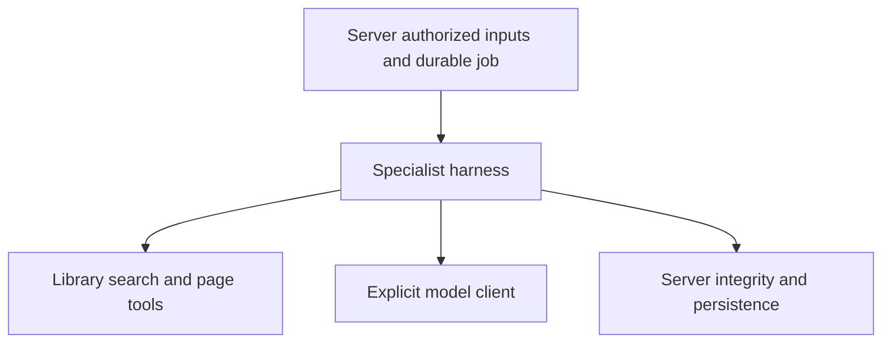

# EquipED evaluation harness

Installable, in-process Python package for SME, Coordinator, GAD and ITSO.
Specialists live under `equiped_harness/agents/`; shared contracts and runtime are
independent of their executable pipelines. The package owns prompts, semantic
scoring/validation, evidence interpretation, reporting and specialist tools.
Server admission, authorization, active rubric selection, local data storage,
model resolution, durable execution and persistence remain application-owned.
The public API rechecks snapshot integrity, manifest compatibility and evaluation
binding before any tool or model call.

## Supported execution seam

```python
from equiped_harness import EvaluationRequest, ExecutionConfig, evaluate

request = EvaluationRequest(
    evaluation_id=evaluation_id,
    document_id=document_id,
    form_snapshot=snapshot,
    chunk_infos=tuple(prepared_chunks),
    canonical_source_text=source_text,  # required by SME / Coordinator
    curriculum_id=curriculum_id,       # Coordinator context
    curriculum_context=curriculum_text,
)
result = evaluate(request, client, ExecutionConfig())
```

The caller supplies an immutable verified snapshot, prepared inputs, explicit
execution controls and a client implementing `ModelClient.generate_result` with
neutral `ResponseContract` and shared `CompletionResult`. Production integration
uses flat server `evaluations/{runner,dispatch,context,harness_adapter}.py` modules.
The adapter translates host configuration and wraps the core model transport.
Database-backed envelope lookup belongs to server `rubrics/envelopes.py`.
There are no server imports, database callbacks, environment loaders or implicit
model clients in the library. Request mappings are copied and frozen; execution
scopes reset on exit and are installed independently in each worker.

For ITSO, provide explicit authorized tools. The harness performs search and page
retrieval before its two model requests and replaces supplied cached reports:

```python
from equiped_harness import ExecutionControl, ToolConfig
from equiped_harness.tools.http import PinnedHTTPS

result = evaluate(
    request, client, ExecutionConfig(),
    tools=ToolConfig(enabled=external_access_authorized, transport=PinnedHTTPS()),
    control=ExecutionControl(),
)
```

Disabled or missing required tools fail before model execution. Query safety,
provider/redirect/IP validation and byte/time/request limits remain enforced by
the tools. Cancellation is cooperative; a running call retains its bounded
transport deadline. Local institutional policy retrieval remains residency-gated
in the application and follows library-owned policy plans. Unavailable policy
text remains a disclosed limitation.

Public helpers include `envelope_criteria_map_from_snapshot` and
`COORDINATOR_SCORING_RULES`. Specialist scoring helpers are owned by their agent;
shared score-band validation is in `runtime/scoring.py`.
Snapshot UUID binding, versions, provenance, repair and failure behavior are
preserved. Current Coordinator adapter 4 uses explicit immutable snapshots; the
manifest default remains v2 for legacy callers. Historical v1–v5 meanings and saved-result readers
remain supported; their obsolete execution pipelines have been removed.

Coordinator's public class lives in `agents/coordinator/agent.py`. The active
pipeline is rubric adapter 4 / `coordinator_current.v6`, grouped into Organization
& Presentation (5 criteria), Assessment (5 criteria), and qualitative C-01
alignment. `llm_rubric_guidance` guides all ten scored criteria. The model
generates score, complete finding, and evidence together; no exhaustive counters,
objective inventory, separate validation LLM, or final narrative writer is used.
C-01 is a qualitative 1–4 supplement grounded in SLM and curriculum passages,
with no objective count or denominator, excluded from the official mean and PDFs.

Production adapter-4 requests receive document/source-bound rankings. Cloud
retrieval v2 uses three rubric queries and selects up to 12 exact SLM passages per
group at 800-character granularity. The harness selects bounded curriculum
passages from the authoritative text supplied by the server. Citation IDs attach original
passage text without model retyping. Each group has one bounded repair; invalid
or missing reasoning, evidence, or summary after repair fails the full evaluation
with no partial result or placeholder reasoning. Missing practices may receive
a complete low-score finding (1 or 2) without citation when reasonable. Historical
v1–v5 readers remain supported. Retired adapter snapshots cannot execute and
require a new evaluation under adapter 4.

Supported older execution contracts remain with their specialist. Coordinator's retired execution modules are removed. Retired
ITSO versions are read-only; historical contracts never enable new evaluations.
Their database models and authenticated readers live in the server's
`modules/itso_assessments/`; current scored results use the standard evaluation
results endpoint.



## Install and verify

Native `uv_build>=0.11.25,<0.12` backend; use UV 0.11.25 or newer. The server
UV lock installs the local editable dependency; Docker copies the package before
frozen sync, and development mounts its sources. No wheel path or `sys.path`
workaround is needed.

From the repository root:

```sh
pnpm harness:test
pnpm server:lint
pnpm server:format
# Run independently of the server environment:
uv run --project libs/evaluation-harness pytest libs/evaluation-harness/tests
# With dependencies already installed:
apps/server/.venv/bin/python -m pytest libs/evaluation-harness/tests
uv build --offline libs/evaluation-harness
```

Tests cover actual four-specialist fake-client execution, deep immutability,
configuration/thread isolation, repair, frozen JSON/hash compatibility and
installed-package imports without the backend path. Server, ORM and environment dependencies are forbidden. Network operations are
restricted to explicit tool modules; tests use scripted transports.

Current ITSO scored execution uses adapter 3 only. Adapters 1 and 2 remain in the manifest registry for immutable historical snapshot validation; the harness does not execute them. The read-only `agents.itso.compatibility.contracts` module preserves historical source hashes, spans, evidence facts, and stored-result validation. The v3 pipeline uses the existing rubric-guidance pipeline and two fixed role-separated requests under one model deadline: criteria 1–2 receive locally selected verbatim module excerpts and independent public sources; criteria 3–5 receive module text. Required harness-owned public-reference tools create a fresh bounded report before the model stages. The low-level prepared-report seam is used for fixture-based pipeline tests; production calls the public execution API. Missing or unusable reports fail before model transport. Both groups must pass before the canonical five-score result completes, and both actual model generations retain the existing score response contract. Legacy internal-only templates and local precheck signals are not part of current ITSO execution.

Public citation extraction supports dated and undated APA entries, including corporate authors, within recognized bibliography and numbered Learning resources sections. Date markers such as `(n.d.)` are metadata rather than work titles. When a report has no usable source passage, `[ITSO_REFERENCE_CHECK]` logs bounded numeric search/candidate/source counts and source failure counts before the execution error. These diagnostics exclude queries, titles, URLs, passages, and module text; distinguish an empty candidate set from failed source retrieval when investigating a fast failure.

Public-reference retrieval retains completed source checks when a later registry or search lookup fails. Transient provider 5xx responses receive at most one retry per request; title-only fallback and subsequent references share the original 45-second deadline and five-reference cap. Individual HTTP, access, malformed-response, response-limit and per-call timeout outcomes remain unavailable reference checks. Deadline exhaustion stops further I/O and preserves completed receipts with explicit coverage limits. Provider scope/security violations and cancellation remain fatal; unsafe source destinations are rejected without following them. An unavailable reference is never a verified match, and a report without a usable retrieved passage still fails before model scoring.

ITSO source citations may use a full retrieved URL or a resolvable `[source N]` report index; every cited index retains a URL mapping in the bounded saved reasoning, with one repair before failure if mappings cannot fit. Reports contain at most five rows. With defined scoring rules, source comparison and detected source acknowledgements/authorship require verbatim module quotations. The document envelope receives validated advisory source findings, selected exact rights/privacy passages, actual excerpt coverage, and available residency-gated local policy clauses. No detected confidentiality concern yields advisory 4 for reviewed extracted text; incomplete ownership or rights evidence supports provisional 3. Quotes for concrete concerns remain mandatory. Policy unavailability is a disclosed limitation and does not block normal evaluation.
